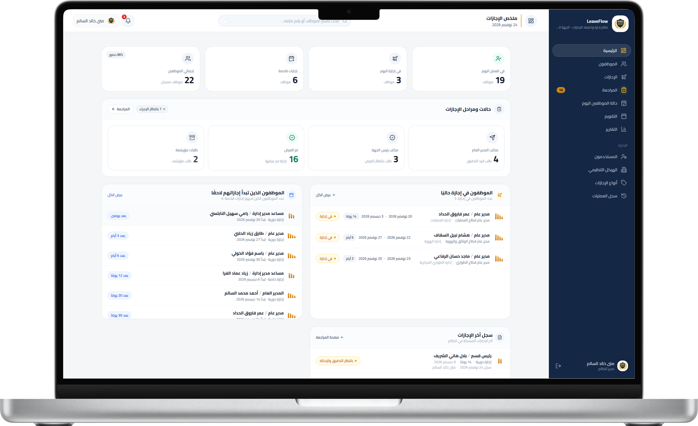
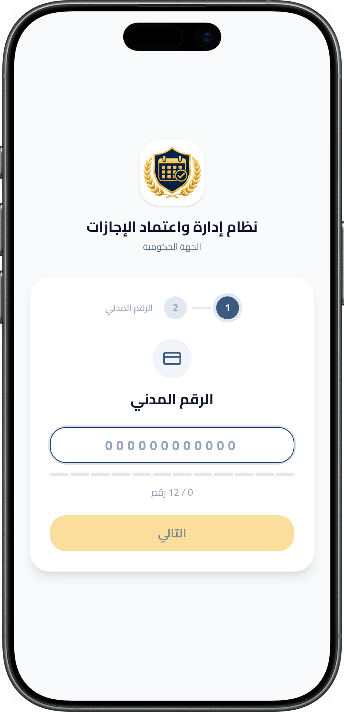
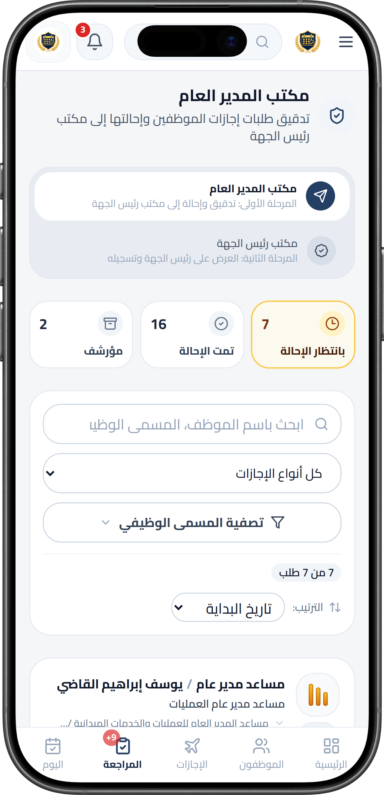
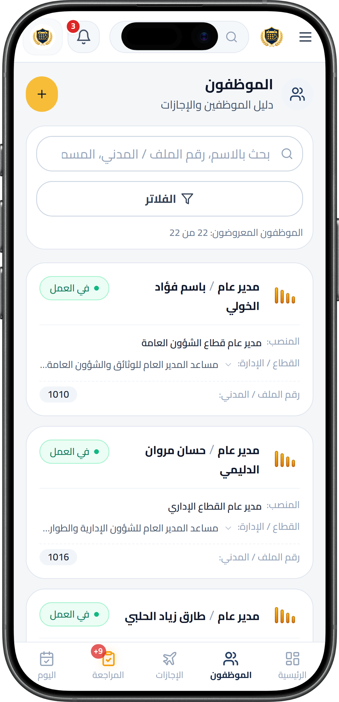

<div align="center">


# LeaveFlow - Leave Management & Approval System

A complete web system for managing employee leave and approving it in two stages - from request submission through review to archiving - with a fully Arabic, right-to-left (RTL) interface designed for official organisations.

*A complete leave-management and two-stage approval system for government-style organisations - employee directory, approval workflow, calendar, reports and a full audit trail. Arabic-first, fully RTL, installable as a PWA.*

</div>



## At a Glance

- **Two-stage approval workflow:** review and referral by the Director General's office, then presentation and approval by the head of the organisation's office, with return-with-reason, archiving, and reopening by the administration.
- **Live dashboard:** who is at work today, who is on leave, upcoming leaves, and the status of every stage of the requests.
- **Complete employee directory:** job titles, sectors and departments, with search filters and a profile for every employee showing their current and upcoming leave and their full history.
- **Leave register & calendar:** a complete register with status tabs (current / upcoming / completed / archived), and a monthly calendar showing the distribution of leaves.
- **Reports & audit trail:** printable reports with an official header, and an audit trail for every action inside the system.
- **Secure sign-in:** sign-in with civil ID + PIN code and OTP sessions, with detailed permissions by role and work scope (sector / department).
- **Fully Arabic PWA:** installable, and works as a mobile web app and on desktop with the same interface and data - Cairo font, and a responsive experience from phones to large screens.

## System Screenshots

| Sign-in screen | Request review & approval |
| --- | --- |
|  |  |

| Leave register | Employee directory |
| --- | --- |
|  |  |

| Employee profile |
| --- |
|  |

## Mobile Version (PWA)

The system is a progressive web app (PWA) that installs on phones and works with the same interface and data on mobile and desktop - bottom navigation, adaptive cards, and every approval stage from the phone:

| Sign-in screen | Dashboard | Request review |
| --- | --- | --- |
|  |  |  |

| Employee directory | Leave register |
| --- | --- |
|  |  |

## Tech Stack

| Layer | Technology |
| --- | --- |
| Frontend | React 18 + TypeScript + Vite 5 |
| Styling | Tailwind CSS 3, Lucide icons |
| Routing & state | React Router 7 |
| Database & auth | Supabase (PostgreSQL + Auth + RLS + RPC) |
| Edge functions | Supabase Edge Functions (the `civil-auth` function for civil-ID sign-in) |
| Dates | date-fns |
| Deployment | PWA (manifest + icons) - any static hosting + a Supabase project |

## Project Structure

```
src/
  pages/         screens (dashboard, review, leaves, employees, calendar, reports...)
  pages/admin/   admin screens (users, organisational structure, audit log)
  components/    shared components (sidebar, forms, headers)
  lib/           Supabase client and connection utilities
  lib/showcase/  demo showcase mode (fictional data inside the browser)
supabase/
  migrations/          database schema, reference data and security policies
  full_schema_setup.sql  full setup for a new database in one step
  functions/civil-auth/  civil-ID sign-in function
```

## Running Locally

### 1) Demo showcase mode (no server needed)

The version shown in the screenshots above runs on fully fictional data inside the browser:

```bash
npm install
VITE_SHOWCASE_MOCK=1 npm run dev
```

Then sign in with any 12-digit civil ID and any 4-digit PIN code - you will be signed in as the system administrator with the full demo data.

> **Showcase note:** this copy is prepared for presentation and review. The organisation shown (a generic "Government Entity") is fictional, and all names and data are generated and fictional. Showcase mode runs only when `VITE_SHOWCASE_MOCK=1` is passed explicitly at build time, and it is **off by default** - any normal build or deployment uses the real Supabase client as-is, and the fictional mode cannot be activated by accident.

### 2) Running with a real Supabase

1. Create a new project on [Supabase](https://supabase.com).
2. Apply the database schema: run `supabase/full_schema_setup.sql` from the SQL editor, or apply the files in `supabase/migrations/` in order.
3. Deploy the edge sign-in function:

   ```bash
   supabase functions deploy civil-auth
   ```

4. Create a `.env` file in the project root:

   ```env
   VITE_SUPABASE_URL=https://your-project.supabase.co
   VITE_SUPABASE_ANON_KEY=your-anon-key
   ```

5. Run the app:

   ```bash
   npm install
   npm run dev
   ```

## Useful Commands

```bash
npm run build       # production build
npm run typecheck   # type checking
npm run preview     # preview the production build locally
```
