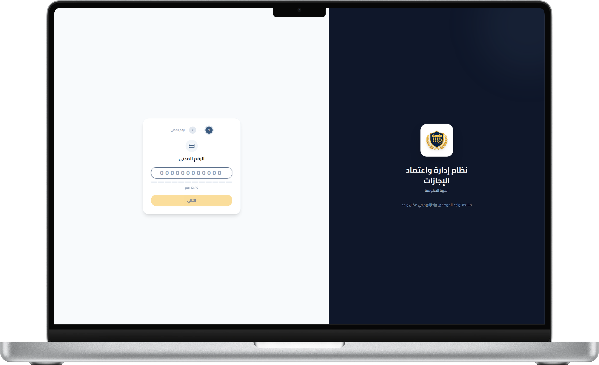
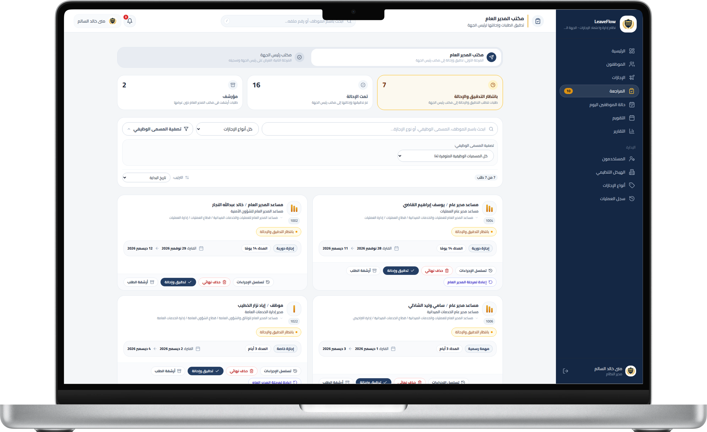
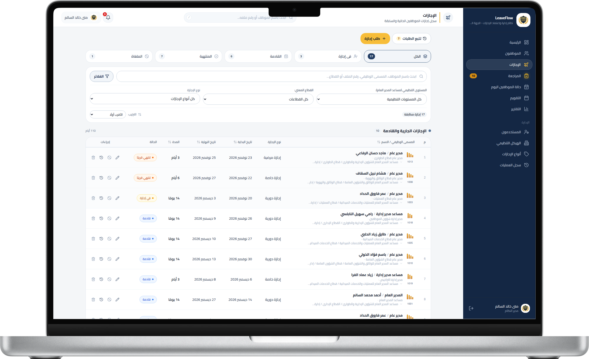
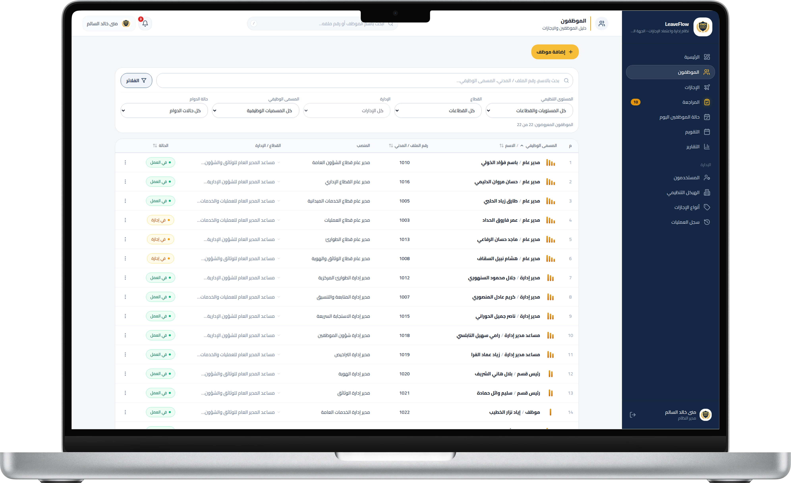
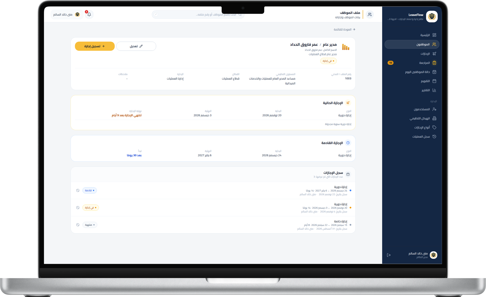
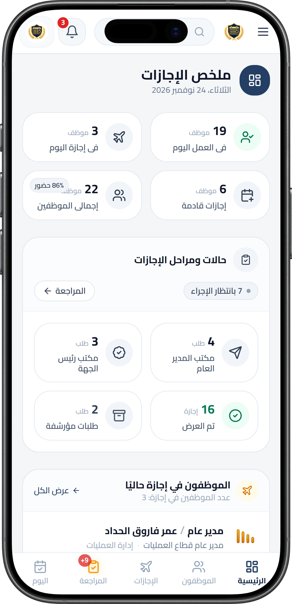
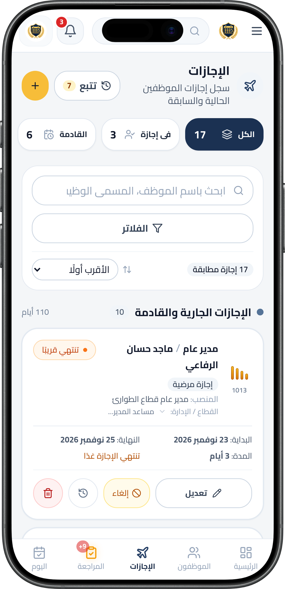

<div align="center">


# LeaveFlow - نظام إدارة واعتماد الإجازات

نظام ويب متكامل لإدارة إجازات الموظفين واعتمادها بمرحلتين - من تقديم الطلب حتى العرض والأرشفة - بواجهة عربية كاملة الاتجاه (RTL) مصممة للجهات الرسمية.

*A complete leave-management and two-stage approval system for government-style organisations - employee directory, approval workflow, calendar, reports and a full audit trail. Arabic-first, fully RTL, installable as a PWA.*

</div>


## لمحة سريعة

- **سير اعتماد بمرحلتين:** تدقيق وإحالة من مكتب المدير العام، ثم عرض واعتماد من مكتب رئيس الجهة، مع إمكانية الإرجاع بسبب أو الأرشفة أو إعادة الفتح من الإدارة.
- **لوحة متابعة حية:** من في العمل اليوم، من في إجازة، الإجازات القادمة، وحالة كل مرحلة من مراحل الطلبات.
- **دليل موظفين كامل:** المسميات الوظيفية، القطاعات والإدارات، مع فلاتر بحث وملف لكل موظف يعرض إجازته الحالية والقادمة وسجله الكامل.
- **سجل إجازات وتقويم:** سجل شامل بتبويبات الحالة (جارية / قادمة / منتهية / مؤرشفة)، وتقويم شهري يعرض توزيع الإجازات.
- **تقارير وسجل عمليات:** تقارير قابلة للطباعة بترويسة رسمية، وسجل تدقيق (Audit Trail) لكل إجراء داخل النظام.
- **دخول آمن:** تسجيل بالرقم المدني + رمز PIN وجلسات OTP، وصلاحيات مفصلة حسب الدور ونطاق العمل (قطاع / إدارة).
- **PWA عربي بالكامل:** قابل للتثبيت، ويعمل كتطبيق ويب على الموبايل (Mobile Web App) وسطح المكتب بنفس الواجهة والبيانات - خط Cairo، وتجربة متجاوبة من الجوال حتى الشاشات الكبيرة.

## لقطات من النظام

| شاشة الدخول | مراجعة واعتماد الطلبات |
| --- | --- |
|  |  |

| سجل الإجازات | دليل الموظفين |
| --- | --- |
|  |  |

| ملف الموظف |
| --- |
|  |

## نسخة الموبايل (PWA)

النظام تطبيق ويب تقدمي (PWA) يُثبّت على الجوال ويعمل بنفس الواجهة والبيانات على الموبايل وسطح المكتب - تنقّل سفلي، بطاقات متكيفة، وكل مراحل الاعتماد من الهاتف:

| شاشة الدخول | لوحة المتابعة | مراجعة الطلبات |
| --- | --- | --- |
|  |  |  |

| دليل الموظفين | سجل الإجازات |
| --- | --- |
|  |  |

## التقنيات

| الطبقة | التقنية |
| --- | --- |
| الواجهة | React 18 + TypeScript + Vite 5 |
| التنسيق | Tailwind CSS 3، أيقونات Lucide |
| التوجيه والحالة | React Router 7 |
| قاعدة البيانات والمصادقة | Supabase (PostgreSQL + Auth + RLS + RPC) |
| دوال طرفية | Supabase Edge Functions (دالة `civil-auth` لدخول الرقم المدني) |
| التواريخ | date-fns |
| النشر | PWA (manifest + أيقونات) - أي استضافة ثابتة + مشروع Supabase |

## بنية المشروع

```
src/
  pages/         الشاشات (لوحة المتابعة، المراجعة، الإجازات، الموظفون، التقويم، التقارير...)
  pages/admin/   شاشات الإدارة (المستخدمون، الهيكل التنظيمي، سجل العمليات)
  components/    مكونات مشتركة (الشريط الجانبي، النماذج، الترويسات)
  lib/           عميل Supabase وأدوات الاتصال
  lib/showcase/  وضع العرض التجريبي (بيانات وهمية داخل المتصفح)
supabase/
  migrations/          مخطط قاعدة البيانات والبيانات المرجعية وسياسات الأمان
  full_schema_setup.sql  إعداد كامل بقاعدة بيانات جديدة بخطوة واحدة
  functions/civil-auth/  دالة الدخول بالرقم المدني
```

## التشغيل محليًا

### 1) وضع العرض التجريبي (بدون أي خادم)

النسخة المعروضة في اللقطات أعلاه تعمل ببيانات وهمية بالكامل داخل المتصفح:

```bash
npm install
VITE_SHOWCASE_MOCK=1 npm run dev
```

ثم ادخل بأي رقم مدني من 12 خانة وأي رمز PIN من 4 أرقام - ستسجل دخولك كمدير النظام مع كامل البيانات التجريبية.

> **ملاحظة العرض (Showcase):** هذه النسخة مخصصة للعرض والمراجعة. الجهة الظاهرة («الجهة الحكومية») جهة افتراضية، وجميع الأسماء والبيانات مولّدة ووهمية. وضع العرض يعمل فقط عند تمرير `VITE_SHOWCASE_MOCK=1` صراحة وقت البناء، وهو **مغلق افتراضيًا** - أي بناء أو نشر عادي يستخدم عميل Supabase الحقيقي كما هو، ولا يمكن تفعيل الوضع الوهمي بالخطأ.

### 2) التشغيل مع Supabase حقيقي

1. أنشئ مشروعًا جديدًا في [Supabase](https://supabase.com).
2. طبّق مخطط قاعدة البيانات: نفّذ `supabase/full_schema_setup.sql` من محرر SQL، أو طبّق ملفات `supabase/migrations/` بالترتيب.
3. انشر دالة الدخول الطرفية:

   ```bash
   supabase functions deploy civil-auth
   ```

4. أنشئ ملف `.env` في جذر المشروع:

   ```env
   VITE_SUPABASE_URL=https://your-project.supabase.co
   VITE_SUPABASE_ANON_KEY=your-anon-key
   ```

5. شغّل التطبيق:

   ```bash
   npm install
   npm run dev
   ```

## أوامر مفيدة

```bash
npm run build       # بناء الإنتاج
npm run typecheck   # فحص الأنواع
npm run preview     # معاينة بناء الإنتاج محليًا
```
